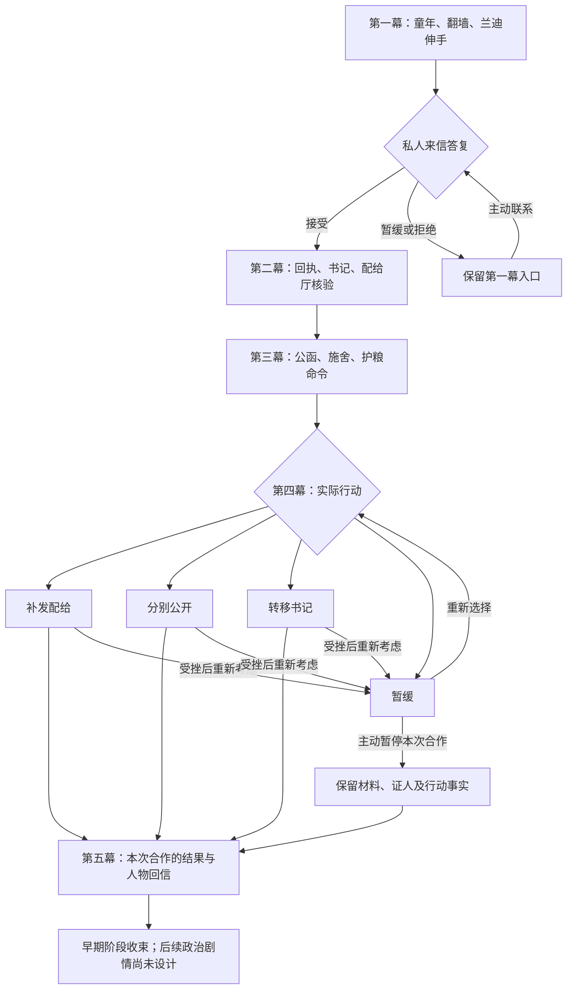

# 跨幕流程与状态

> 本页是跨幕剧情设计，不是运行时状态表。当前行为读 [源码](README.md#设计与代码)，实际存档键见 [存档归属](../save-ownership.md#王国篇-k2k5-初步合作)；下方概念名只是讨论用名，不是 API、DSL 属性或存档键。原 K5 终局属性废弃，五个远期结局只作规划，不据旧结束属性切断全篇。

## 主流程

第二幕停止调查可从 `K2-E1`、`K2-E2` 直接到 `K2-E4`；未核验段替代核验段。第三幕按 `K3-E1 -> K3-E2 -> K3-E3 -> K3-E4` 展开，每项拒绝、缺席、未知也算本项终态，不生成虚构成功。第四幕一次只执行一项行动；行动结束可进入第五幕阶段回信，部分、失败仍可重新考虑。第五幕按本次真实经历回信，回看不重复交件、交付或结算；不判定全篇终局，也不把一次行动固定为穗音此后的政治立场

## 剧本与属性

- `[背景图:…]`、`[发话:…]`、`[等待…秒]` 等是编辑与演出指令，不显示在角色文案中。
- `text` 块只含台词、旁白、信件或按钮文字。一个块对应一段可独立修改的文案。
- `yaml` 块集中记录事件设计属性。它们不可直接传给当前 ODF 执行。
- 条件段默认只替换它明确标出的同类段落；若是额外信息则明确写“附加”。失效角色不得进入会谈或成功图。

## 状态与归属

| 状态 | 值与意义 | 写入位置 |
| --- | --- | --- |
| `kingdomAct` | 当前章节；早期范围为1至5，不表示全篇只有五幕 | 接受私人信及各幕阶段收束 |
| `inquiryMode` | formal / private / stopped | 两份回执的答复 |
| `recordCustody` | none / player / envoy / shared / lost，描述本篇材料持有人概况 | 实际寄达、交接、传播或确认失效 |
| `evidenceLevel` | none / copies / verified，当前可交付材料中的最高文书程度 | 收到副本、核验取得抄件，遗失时重新计算 |
| `verifiedKnowledge` | 曾亲自核验过原簿，文书失去后仍可为true | 配给厅核验成功 |
| `clerkStatement` | 本篇书记声明已实际送达 | 书记访谈，不由普通情报交易写入 |
| `witnessConsent` | private / named，是否同意公开姓名；转移另需重新同意 | 同一名书记明确答复 |
| `witnessState` | unknown / available / withdrawn / absent / dead / safe；unknown表示本轮尚未联系书记 | 书记访谈、真实人物状态与接应结果 |
| `hallResult` | verified / denied / expired / declined / unavailable | 赴约终态 |
| `envoyResult` | retained / handed_over / unavailable / refused | 公函答复与实际交件 |
| `charityResult` | observed / interrupted / hearsay | 参加与分配实际结果 |
| `charityReport` | 是否有玩家现场取得的报告 | 观礼到场或实际中断 |
| `guardResult` | receipt_received / petition_sent / unknown / declined | 护粮签收或请求的终态 |
| `courtAttention` | low / medium / high，宫廷掌握的本篇问询程度 | 正式问询、登记或公开实际形成的消息 |
| `suiyinPosition` | 旧稿 undecided / repair / publish / protect，仅描述本次行动取向，不是最终政治立场；是否仍需独立保存待修订 | 第四幕行动选择与结果 |
| `routeOutcome` | none / success / partial / failed | 同一行动真实终态 |
| `routeFailureReason` | none / cancelled / expired / obstructed / withdrawn / lost_contact / death，区分未完成原因 | 行动终态；重新考虑清除本轮原因，保留历史结果 |

旧稿 `kingdomEnding` 的 none / repair / publish / protect / lost / open 不再是有效实现设计，不迁移为五个远期结局，也不新增这一存档键。早期行动结果、阶段回信和全篇结局分别理解；新的最终结局字段与条件尚未设计

持有人概况不能替代逐份清单。清单分别记录初始回执、署名声明、原簿核验抄件、现场报告、交件收条与运输回报，以及玩家、王国和两个外部来源的持有事实。原簿始终留在配给厅；“交回文书”只交玩家拥有的相应材料，不代表收回所有副本。`shared` 只在两组独立外部来源确认收到后成立；一组收到也须保存该组持有，不能当成全失。

最高文书程度描述回执与核验材料；署名声明、现场报告仍单独判断可否核对。不能因为 `evidenceLevel = none` 忽略其他有效材料。未知去向是未知，不是销毁；持有人死亡不自动销毁物件。遗失不抹去曾核验的知识，但知识不能被当成可交付原件。

## 本次行动与结果

| 行动 | 成功条件 | 部分或受挫 | 阶段回信候选素材 |
| --- | --- | --- | --- |
| repair | 本篇名单足额核对并实际补发 | 部分领到，或未完成补发 | K5-E1各事实版本，去除终局定位 |
| publish | 两组独立来源实际确认收到 | 只一组确认，或全部未确认 | K5-E2各事实版本，去除终局定位 |
| protect | 同一书记明确同意并实际安全抵达或入住 | 撤回、未接到、受阻、失联、死亡 | K5-E3对应人物状态版本，去除终局定位 |
| undecided | 暂缓，不假定成功 | 玩家主动暂停本次合作；材料全失单独记录 | K5-E5或K5-E4的阶段素材，不是全篇开放或失去结局 |

“选择保护”与“已经救下”分别表达；失败后仍可记下保护意愿，阶段回信不得使用成功段。接受某项行动保存执行中状态，完成前其他行动入口不可接受；关闭阅读不会取消实际行动。受挫后重新考虑清除本轮待选行动、结果与失败原因，不清除已经领粮、送达、公开或死亡的事实。未进入书记访谈时保持unknown，不凭未联系把书记判成离开或死亡

## 时间与失效

画卷停留、动画、切句使用现实秒，暂停或回看只改阅读位置。手动 Letter 没有读完倒计时；行动期限按游戏日计算，在确认前显示绝对截止时间，不因再次打开信件重置。

行动时钟与地点可达要求已接入 ODF。取消、到期、不可用、死亡、阻碍与失联保存各自事实；已接受行动不因切换叙事者冻结。书记同意的安全目的地独立于公开第二机构保存，已经在商队中的书记不会在重新考虑时复制到会面点

当前存档停用 RHAH 新内容时不再创建本篇新案件；已有待办按停用原因关闭，不制造完成。`I-001`..`I-051`、既有 `N-` 节点、`journalCases`、`longFollows` 和原有信任不参与本篇解锁或计数。兰迪的随机事件自然发生，本篇不强制插入灾难、重复发送普通事件或调整其权重。
